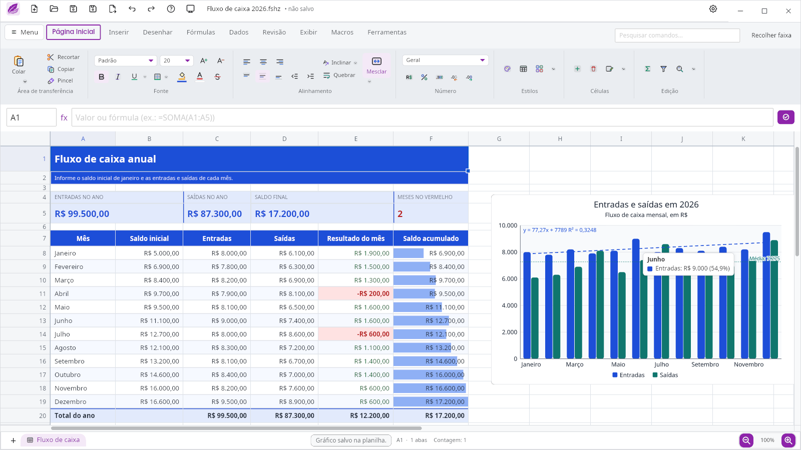
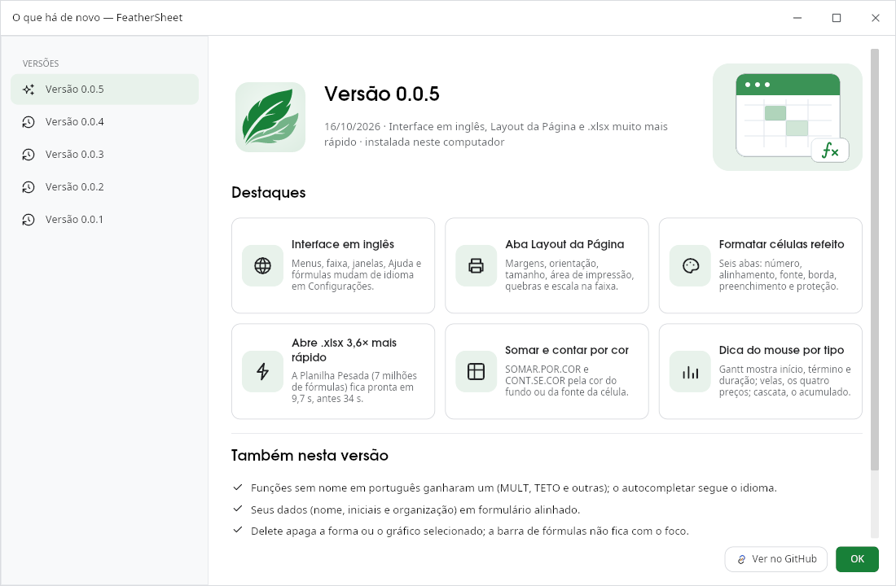
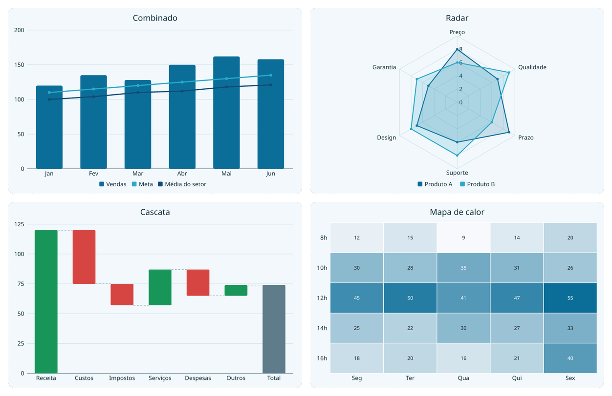
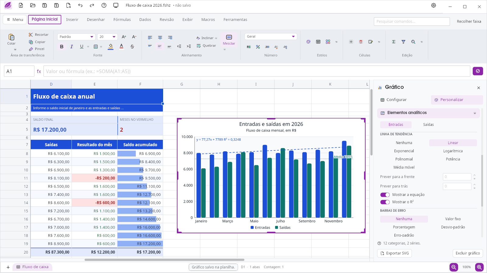
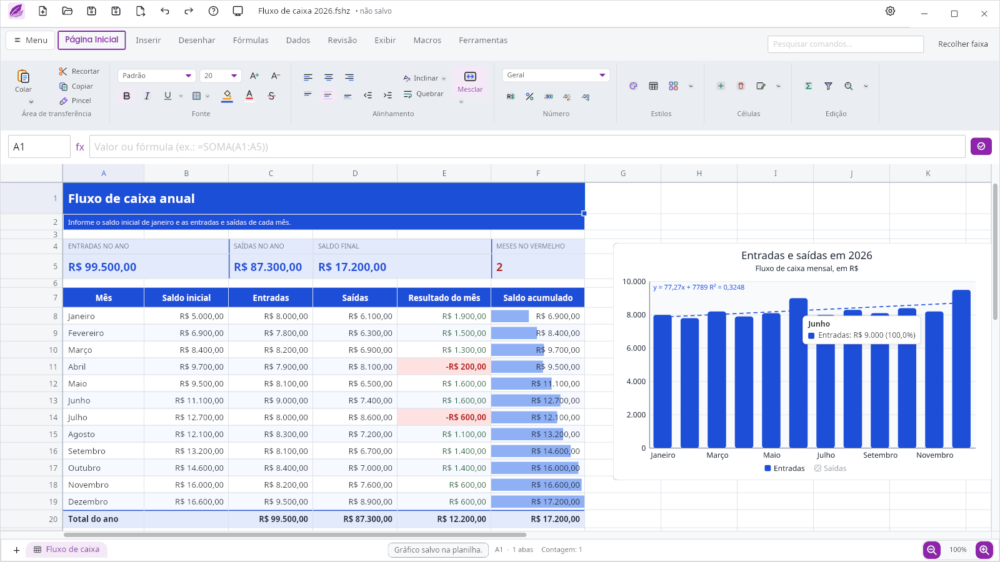

# FeatherSheet

**Planilha da suíte FeatherOffice, escrita em Rust com interface nativa Iced.**
Abre arquivos enormes, calcula em paralelo, fala português nas fórmulas e roda
inteira na sua máquina: sem conta, sem login, sem telemetria.

> **Estado:** em desenvolvimento ativo. Versão alpha prevista para **30/10/2026**.



## Baixar

| Sistema | Arquivo | Como instalar |
|---|---|---|
| **Windows 10/11** | [FeatherSheet-windows-x64.exe](https://github.com/FeatherOffice/feathersheet/releases/latest/download/FeatherSheet-windows-x64.exe) | abra o instalador (não pede administrador) |
| **Linux** (Ubuntu, Debian, Mint…) | [feathersheet-linux-amd64.deb](https://github.com/FeatherOffice/feathersheet/releases/latest/download/feathersheet-linux-amd64.deb) | `sudo apt install ./feathersheet-linux-amd64.deb` |
| **Linux** (qualquer distribuição) | [feathersheet-linux-x86_64.tar.gz](https://github.com/FeatherOffice/feathersheet/releases/latest/download/feathersheet-linux-x86_64.tar.gz) | extraia e rode `./instalar.sh` |
| **macOS** | — | ainda não disponível |

Todas as versões e as somas de verificação (`SHA256SUMS`) ficam na
[página de versões](https://github.com/FeatherOffice/feathersheet/releases).
Para atualizar, baixe o arquivo novo e instale por cima: o `apt` e o
instalador do Windows substituem a versão anterior.

> A v0.0.1 para Linux exige Ubuntu 26.04 ou mais novo (glibc 2.43).

---

## Novidades da v0.0.5



A mesma janela abre sozinha na primeira vez depois de atualizar (e fica no
menu Ajuda, em *O que há de novo*).

## O que já faz

| Área | Destaques |
|---|---|
| **Fórmulas** | 457 das 520 funções do Excel, com nomes em português ou inglês conforme o idioma da interface; avaliar fórmula passo a passo; matrizes dinâmicas, `LAMBDA`, voláteis |
| **Arquivos grandes** | até 100 milhões de linhas; abre `.parquet` e `.csv` grande; cálculo paralelo com invalidação seletiva; rodapé com soma e contagem instantâneas |
| **Excel** | abre e grava `.xlsx` com cores do tema, formas, imagens, degradês e gráficos na posição certa; lê `.xlsm` e converte as macros VBA para JavaScript |
| **Gráficos** | 25 tipos (combinado, cascata, radar, Gantt, mapa de calor…), dica do mouse e legenda clicável; gráficos editáveis com o painel *Formatar gráfico* (temas, cor por ponto, eixos, rótulos), pelo motor comum [`feather-charts`](https://github.com/FeatherOffice/feather-charts) |
| **Dados** | tabelas, tabela dinâmica, formatação condicional, validação, agrupar/subtotal, proteger planilha, Texto para colunas |
| **Macros** | editor Alt+F11 com macros em JavaScript (interpretador Boa, local) guardadas dentro do próprio arquivo |
| **IA local** | servidor MCP (`feathersheet-mcp`) para uma IA ler, escrever e conferir planilhas por stdio |
| **Desenho** | caneta com pressão (mesa digitalizadora) sobre a planilha |

### Gráficos



| | |
|---|---|
|  |  |
| **Formatar gráfico:** tendência (linear, exponencial, logarítmica, polinomial, potência, média móvel) com equação e R², barras de erro e linhas de máximo, mínimo e média | **Legenda clicável e dica do mouse:** clique num item para ocultar a série (fica hachurado); a dica mostra categoria, série, valor e porcentagem, e é personalizável |

## Desempenho: a Planilha Pesada

Para medir velocidade usamos um `.xlsx` gerado por script, com a cara de
uma planilha de vendas grande:

| Aba | Conteúdo | Fórmulas |
|---|---|---|
| **Dados** | 1.000.000 de linhas × 13 colunas: data, região, produto, quantidade, preço e 7 colunas calculadas (multiplicação, `SE` aninhado, `MÊS`, `PROCX` numa tabela de produtos e uma corrente em que cada linha soma a anterior) | 7.000.000 |
| **Produtos** | 200 produtos com `SOMASES`, `CONT.SES` e ticket médio sobre o milhão de linhas | 600 |
| **Resumo** | líquido e pedidos por região e mês (`SOMASES`/`CONT.SES` sobre 1 milhão de linhas), `SOMARPRODUTO`, `MÉDIASES` | 207 |
| **Total** | **13 milhões de células** | **7.000.807** |

O arquivo não traz os resultados guardados (`fullCalcOnLoad`): tudo é
calculado ao abrir.

| AMD Ryzen 7 5700G, 16 threads, 32 GB | v0.0.4 | v0.0.5 |
|---|---|---|
| Ler o `.xlsx` | 27,8 s | **7,4 s** |
| Calcular as 7 milhões de fórmulas | 6,3 s | **2,4 s** |
| Até a planilha pronta | ~34 s | **9,7 s** |

A coluna da v0.0.4 vem do console do app (F12); a da v0.0.5, da bancada
`medir_abrir_calcular` (o mesmo código de
abrir e calcular, sem a janela).

Para comparar, o **Microsoft Excel** abrindo o mesmo arquivo num notebook
com Intel Core Ultra 7 155H e 64 GB levou **1 min 24,9 s** para carregar e
terminou de calcular as fórmulas em **1 min 36,8 s** (cronometrado à mão).
As máquinas são diferentes, então a comparação é uma referência, não uma
medida exata.

Para gerar o arquivo e testar na sua máquina (Python 3, sem bibliotecas
externas; o segundo argumento, opcional, é o número de linhas):

```sh
python3 scripts/gerar_xlsx_pesado.py Planilha_Pesada.xlsx 1000000
```

## Paridade com o Excel

| O que se compara | Placar | Detalhe |
|---|---|---|
| **Funcionalidades** (comandos da faixa, botão por botão) | **211 / 290** (72,8%) | [`PARIDADE-EXCEL.md`](docs/planejamento/PARIDADE-EXCEL.md) · [avaliação geral](docs/planejamento/PARIDADE-AVALIACAO.md) |
| **Funções de planilha** | **457 / 520** | [catálogo das funções](docs/funcionalidades/FUNCOES.md) · [as que faltam](docs/planejamento/FUNCOES-FALTANTES.md) |
| **Funções do VBA** (conversor VBA → JavaScript) | **52** cobertas e **12** parciais, de **141** | [`PARIDADE-VBA-FUNCOES.md`](docs/planejamento/PARIDADE-VBA-FUNCOES.md) |

Os placares medem amplitude (o comando ou a função existe e funciona), não
fidelidade visual; cada documento explica o critério.

## Formato `.fshz`

O arquivo nativo é um contêiner compactado com **histórico Git embutido**
(feito com [`gix`](https://github.com/Byron/gitoxide), Rust puro): cada
gravação pode virar uma versão consultável, sem servidor nenhum.

## Estrutura

| Crate | Papel |
|---|---|
| [`feathersheet-core`](crates/feathersheet-core) | o motor: referências, valores, fórmulas e recálculo |
| [`feathersheet-io`](crates/feathersheet-io) | `.fshz`, `.xlsx`, `.xlsm`, `.csv` e `.parquet` |
| [`feathersheet-gui`](crates/feathersheet-gui) | a interface nativa em Iced |
| [`feathersheet-macros`](crates/feathersheet-macros) | macros JavaScript no interpretador Boa |
| [`feathersheet-vba`](crates/feathersheet-vba) | conversor de macros VBA para JavaScript |
| [`feathersheet-mcp`](crates/feathersheet-mcp) | servidor MCP para IA local |
| [`feathersheet-ponte`](crates/feathersheet-ponte) | camada de comandos da interface antiga (referência de paridade) |

Bibliotecas comuns da suíte usadas aqui:
[`feather-io`](https://github.com/FeatherOffice/feather-io) (arquivos, tabelas, imagens e macros),
[`feather-ui`](https://github.com/FeatherOffice/feather-ui) (tema, ícones e componentes),
[`feather-charts`](https://github.com/FeatherOffice/feather-charts) (gráficos),
[`feather-draw`](https://github.com/FeatherOffice/feather-draw) (desenho vetorial, SVG e PDF) e
[`feather-shapes`](https://github.com/FeatherOffice/feather-shapes) (formas e ícones).

## Compilar

As bibliotecas da suíte entram por caminho: clone-as lado a lado na mesma pasta.

```sh
mkdir FeatherOffice && cd FeatherOffice
for r in feathersheet feather-io feather-ui feather-charts feather-shapes; do
  git clone https://github.com/FeatherOffice/$r
done
cd feathersheet/crates/feathersheet-gui
cargo run --release
```

```text
FeatherOffice/
├── feathersheet/      ← este repositório
├── feather-io/        ← arquivos, tabelas, imagens e macros
├── feather-ui/        ← tema, ícones e componentes
├── feather-charts/    ← gráficos
└── feather-shapes/    ← formas e ícones
```

No Linux, o Iced precisa das bibliotecas de janela do sistema (`libxkbcommon`,
`libwayland` ou `libx11`, `libfontconfig`).

## Privacidade

Tudo roda localmente. Nenhum conteúdo de planilha sai da máquina; não há conta,
login, telemetria nem servidor. Conectores que buscam dados de fora só agem por
pedido explícito e em mão única.

## Documentação

- [Roadmap até a 1.0](ROADMAP.md) — o que falta para ficar 100% funcional
- [Índice da documentação](docs/README.md)
- [Registro de tarefas](docs/REGISTRO-DE-TAREFAS.md) — histórico das entregas até a separação do repositório

## Licença

[GPL-3.0](LICENSE).
